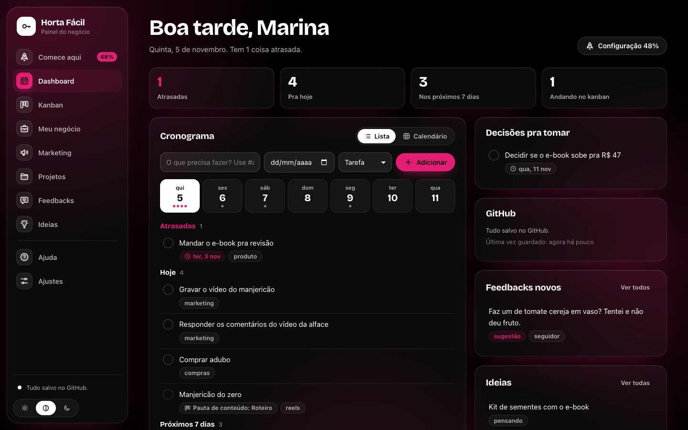
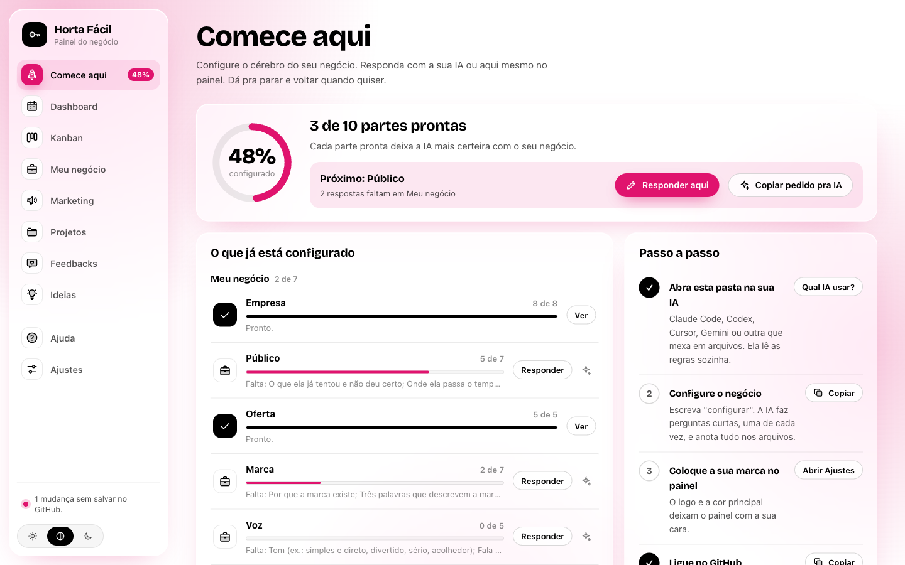
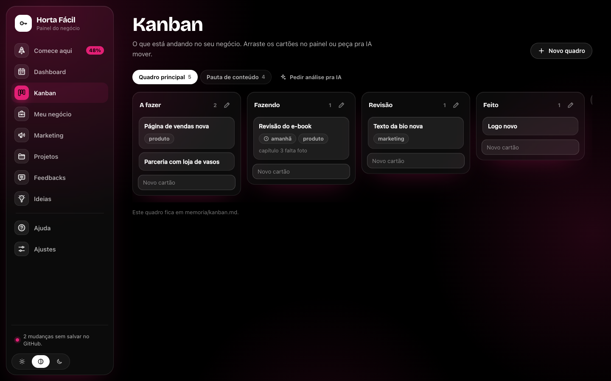
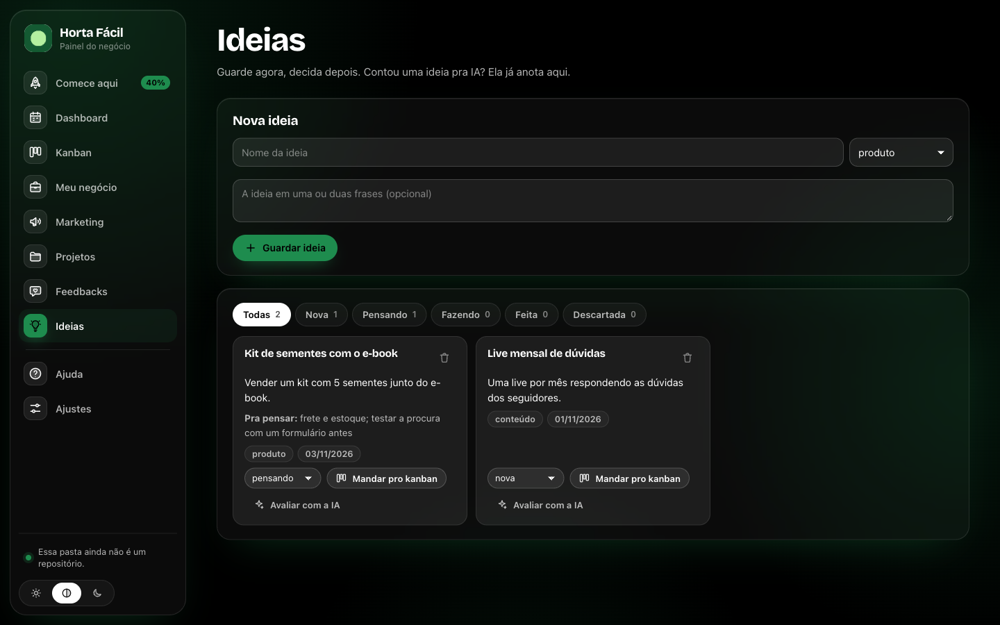
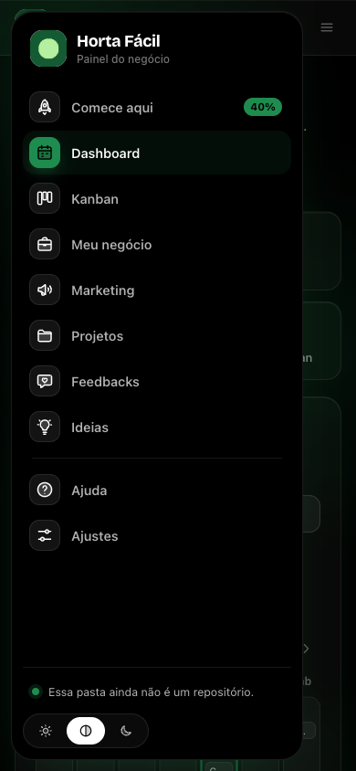

<div align="center">

# TemplateKeyLab

**O cérebro do seu negócio numa pasta.**

A sua IA lê, aprende sozinha e organiza tudo. Um painel bonito mostra o que está acontecendo.

Pra canal no YouTube, software, site, loja, serviços, negócio local ou produto digital.

[Comece aqui](COMECE-AQUI.md) &nbsp;|&nbsp; [Ajuda](AJUDA.md) &nbsp;|&nbsp; [Regras da IA](AGENTS.md)

<br>



<sub>O painel com um negócio de exemplo (fictício).</sub>

</div>

---

## O que é

Uma pasta com tudo que importa do seu negócio: quem você é, o que vende, pra quem, a sua marca, a sua voz, as suas metas, as suas tarefas, as suas ideias e o que funciona.

Tudo em arquivos de texto simples (`.md`). Você abre a pasta na sua IA e conversa. A IA:

- **configura** o seu negócio com perguntas curtas, uma de cada vez;
- **aprende sozinha** com o que você conta (feedback, ideia, decisão, correção, tarefa), sem você precisar de comando;
- **segue receitas** prontas pras tarefas que se repetem;
- **descobre o que funciona** no seu marketing, com os seus números.

E um **painel web** mostra tudo: o que falta configurar, o cronograma, o kanban, os testes, o gráfico dos números, o que a IA escreveu, os feedbacks, as ideias, a sua mentalidade (o seu sonho, as crenças e a prática de todo dia) e a ajuda. Tem busca (Cmd+K) e um **chat com a sua IA** do lado.

Não precisa saber programar. Não precisa instalar nenhuma biblioteca.

## Pra quem é

Pra quem tem (ou quer ter) um negócio e usa IA no dia a dia:

| Tipo de negócio | O que a configuração cria a mais |
|---|---|
| Canal ou criador de conteúdo | Uma pasta por conteúdo, a pauta e o método pra achar o que viraliza no SEU canal |
| Software, app ou SaaS | Roadmap, bugs, funcionalidades, versões e métricas |
| Site, blog ou loja online | Páginas, melhorias, SEO, produtos, políticas e pedidos |
| Serviços (agência, freela, consultoria) | Funil de clientes e uma pasta por cliente |
| Negócio local (loja, restaurante, clínica) | Respostas prontas, avaliações e promoções |
| Curso, mentoria ou produto digital | Conteúdo do produto, vendas, lançamentos e página de vendas |

Dá pra combinar perfis (um canal que vende curso, por exemplo).

## Comece em 4 passos

1. **Pegue a pasta.** No GitHub, clique em **Use this template**, depois em **Create a new repository**, e marque **Private**. (Ou baixe o ZIP.)
2. **Instale o Node** (versão LTS) em [nodejs.org](https://nodejs.org). É só pro painel.
3. **Abra a pasta na sua IA** (Claude Code, Codex, Cursor, Gemini CLI, Copilot...) **e diga oi.** A IA abre o painel no navegador e começa a configurar com você: pergunta o tipo do seu negócio e o resto, uma coisa por vez.
4. **Ligue no GitHub:** quando ela oferecer (ou escreva `salvar no github`). Assim você nunca perde nada.

O painel não abriu? Dois cliques em `ABRIR-PAINEL.command` (Mac) ou `ABRIR-PAINEL.bat` (Windows).

O passo a passo com mais detalhe está em [COMECE-AQUI.md](COMECE-AQUI.md).

> **Não use o botão Fork.** O fork de um repositório público fica público, e o seu negócio ficaria à vista de todo mundo. Use o **Use this template** e marque **Private**.

## Funciona com qual IA?

| IA | Como funciona |
|---|---|
| **Claude Code** | Tudo automático: o resumo no começo da conversa (que liga e abre o painel, e na primeira vez já começa a configuração), o lembrete de aprender em cada mensagem, o anotador, o salvar sozinho no GitHub e os comandos (`/configurar`, `/salvar`, `/nova-area`...) |
| **Codex, Cursor, GitHub Copilot, Windsurf** | Leem o [AGENTS.md](AGENTS.md) sozinhos (o Cursor e o Copilot também têm um arquivo próprio apontando pra ele) e seguem as mesmas regras: no começo da conversa rodam o resumo, que abre o painel |
| **Gemini CLI** | Lê o `GEMINI.md`, que aponta pro AGENTS.md |
| **ChatGPT ou Claude no site** (IA que só conversa) | No painel, clique em **Copiar o cérebro** e cole no começo da conversa. O resto você anota pelo painel |

As regras ficam num arquivo só (o [AGENTS.md](AGENTS.md)), escrito pra qualquer IA entender, das mais simples às mais avançadas.

## O painel

Roda no seu computador, só pra você (`http://localhost:4747`). Tema claro e escuro, em preto, rosa e branco, com efeito de vidro. Depois de configurar, ele usa o **seu logo e a sua cor**.

| | |
|---|---|
|  |  |
| **Comece aqui:** o quanto já está configurado, o que falta e o próximo passo | **Kanban:** arraste os cartões. Vários quadros, colunas do seu jeito |
|  |  |
| **Com a sua marca:** o logo e a cor principal trocam o visual inteiro | **Janela estreita:** o menu vira uma gaveta |

O que tem em cada menu:

- **Comece aqui:** o status da configuração, parte por parte, e o passo a passo. Cada parte tem o botão "Responder" (formulário) e o pedido pronto pra IA.
- **Dashboard:** o cronograma em lista ou calendário (atrasadas, hoje, a semana), as decisões pra tomar, o GitHub, os feedbacks novos e as ideias.
- **Kanban:** os quadros. Todo arquivo com o marcador de kanban vira um quadro sozinho.
- **Meu negócio:** as perguntas do negócio em formulário, e o que a IA anotou (preferências, decisões, aprendizados).
- **Marketing:** o que funciona, os arquivos, as receitas e os pedidos prontos.
- **Projetos:** uma pasta por projeto, cada uma com o seu quadro.
- **Feedbacks:** registre o que falam do negócio e veja o que a IA aprendeu com isso.
- **Ideias:** guarde agora, decida depois. Mande pro kanban com um clique.
- **Ajuda:** perguntas curtas, com busca e com o pedido pronto pra IA em cada resposta.
- **Ajustes:** tema, logo, cor, nome, o GitHub e o "Copiar o cérebro".

Ele **se atualiza sozinho**: quando a IA muda um arquivo, a tela muda junto.

## Como a IA aprende sozinha

Depois de cada mensagem sua, a IA vê se tem algo pra guardar. Se tiver, salva na hora, no arquivo certo, e avisa numa linha:

> 📌 Anotei: o cliente achou o frete caro (memoria/feedbacks.md)

| Se você... | Ela salva em |
|---|---|
| conta algo do negócio | `negocio/` |
| corrige ela ou diz como prefere | `memoria/preferencias.md` |
| conta um feedback, opinião ou sugestão | `memoria/feedbacks.md` |
| tem uma ideia | `memoria/ideias.md` |
| decide algo | `memoria/decisoes.md` |
| fala de algo pra fazer | `memoria/cronograma.md` |
| conta que um trabalho andou | o kanban |
| manda números | `marketing/numeros/` |

Não precisa de comando nenhum pra ela lembrar. No Claude Code, os ganchos (em `.claude/settings.json`) garantem isso:

1. **No começo da conversa:** um resumo do que falta configurar, das tarefas do dia e do GitHub. E o painel liga sozinho.
2. **Em cada mensagem:** um lembrete curto de "aprender sozinho" (o texto fica em `.claude/lembrete.txt`).
3. **A cada 5 mensagens e no fim da conversa:** um anotador escondido (com o Haiku, o modelo mais barato) lê só as mensagens novas e anota o que a IA deixou passar. Dá pra desligar em Ajustes.
4. **No fim de cada resposta:** se você ligou "Salvar sozinho", a pasta vai pro GitHub.

E ela é honesta: questiona quando falta uma peça, confronta quando os números dizem outra coisa e só elogia com motivo. A palavra final é sempre sua.

## O marketing que descobre o que funciona

A área `marketing/` não vem com dicas prontas. Ela vem com **o método** pra descobrir o que funciona com o **seu** público:

1. **Anota** os números e os comentários.
2. **Compara** os melhores contra os piores.
3. **Desconfia:** o que os melhores têm de diferente vira hipótese.
4. **Testa** uma coisa por vez, medindo um número.
5. **Julga** no prazo, com o número.
6. **Guarda:** deu certo, vira regra na sua fórmula (`o-que-funciona.md`).

Vem com as receitas pra IA: analisar números e fazer o placar, estudar um conteúdo que viralizou, escolher o tema, escrever roteiro, planejar a semana, e o que medir no YouTube, no Instagram, no TikTok e nas outras redes. A pauta de conteúdo é um quadro do kanban.

## Personalizar e expandir

Quase tudo se faz pedindo pra IA, sem código:

| Você quer... | Peça | O que acontece |
|---|---|---|
| uma área nova (vendas, financeiro, clientes) | "quero uma área nova pra..." | Ela cria a pasta e o item aparece no menu do painel sozinho |
| um projeto novo | "crie um projeto novo pra..." | Uma pasta com o resumo e um quadro de tarefas |
| automatizar uma tarefa | "quero uma receita pra..." | Um passo a passo que ela segue toda vez (e um comando no Claude Code) |
| uma pergunta nova | "acrescente a pergunta..." | Uma linha nova no arquivo, que já aparece no formulário |
| um quadro novo | Kanban, "Novo quadro" | Um arquivo novo em `memoria/quadros/` |
| mudar o painel | "quero mudar o meu painel..." | Ela segue o mapa do código em `painel/README.md` |

## Nunca perca a sua pasta

- O jeito mais fácil: **Use this template** (Private) e **Open with GitHub Desktop**. Pra salvar: o botão **Salvar agora** do painel, ou peça "salvar".
- Ligue **Salvar sozinho** em Ajustes e a pasta vai pro GitHub depois de cada mudança.
- O painel **avisa e não salva** se o seu repositório estiver público.
- Senhas, chaves e o `.env` ficam de fora (`.gitignore`). Vídeos e `.zip` também, porque são grandes.

## Privacidade

- Os seus dados ficam nos seus arquivos, no seu computador (e no seu GitHub privado, se você ligar).
- O painel só abre no seu computador (`localhost`) e recusa pedidos de outros sites.
- O painel pergunta pra internet se o seu repositório do GitHub está público, sem login e sem mandar nada do seu negócio.
- A tela Ferramentas usa a internet só pra baixar: o vídeo do link que você colou, o baixador (o yt-dlp oficial, do GitHub, conferido pela soma) e, na 1ª transcrição, o modelo de voz (do Hugging Face). A transcrição roda no seu computador: o seu áudio não vai pra lugar nenhum.
- A IA tem a regra de nunca guardar senha, chave, número de cartão, CPF, CNPJ ou dado de banco.

## O que tem na pasta

```
├── AGENTS.md            as regras pra qualquer IA (CLAUDE.md e GEMINI.md apontam pra ele)
├── COMECE-AQUI.md       o passo a passo
├── AJUDA.md             perguntas e respostas (o menu Ajuda do painel)
├── ABRIR-PAINEL.command dois cliques no Mac
├── ABRIR-PAINEL.bat     dois cliques no Windows
├── negocio/             quem você é: empresa, público, oferta, marca, voz, estratégia, concorrentes
├── memoria/             o que a IA aprende: cronograma, kanban, feedbacks, ideias, decisões, aprendizados
├── marketing/           canais, estratégia, o que funciona, testes, pauta, números, virais e o método
├── projetos/            uma pasta por projeto
├── arquivos/            o que você joga aqui (logo, prints, PDFs)
├── saidas/              o que a IA cria (textos, roteiros, propostas)
├── receitas/            o passo a passo das tarefas que se repetem
├── modelos/             moldes: perfis de negócio, área, projeto e receita
├── painel/              o painel web (Node puro, sem dependências)
└── .claude/             os ganchos e os comandos do Claude Code
```

## Precisa de quê

- **Node 18 ou mais novo**, só pro painel ([nodejs.org](https://nodejs.org)). Nada de `npm install`.
- **Git**, pro backup no GitHub (o GitHub Desktop já traz).
- **Uma IA** que mexa em arquivos (ou uma de chat, com o "Copiar o cérebro").

Comandos, se você gosta do terminal:

| Comando | O que faz |
|---|---|
| `npm start` | Liga o painel e abre no navegador (o terminal fica aberto) |
| `npm run painel` | Liga em segundo plano e abre no navegador |
| `npm run parar` | Desliga o painel |
| `npm run status` | Mostra o que falta configurar e o que tem pra hoje |
| `npm run salvar` | Salva no GitHub |

## Dúvidas

Veja a [Ajuda](AJUDA.md) (também no painel, no menu Ajuda) ou pergunte pra sua IA: ela conhece a pasta inteira.

## Licença

Uso livre no seu negócio, inclusive comercial. **Não pode** vender, revender nem distribuir o modelo (ou uma versão modificada dele) como produto, curso, bônus ou template sem autorização. Os termos completos estão em [LICENSE](LICENSE).

## Créditos

Feito pela [Goldkeylab](https://github.com/goldkeylab1).
A fonte dos títulos do painel é a [Bricolage Grotesque](https://github.com/ateliertriay/bricolage) (SIL Open Font License, em `painel/public/fontes/`).
